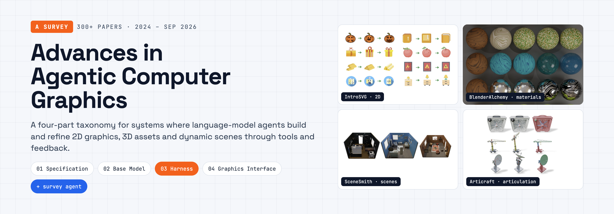
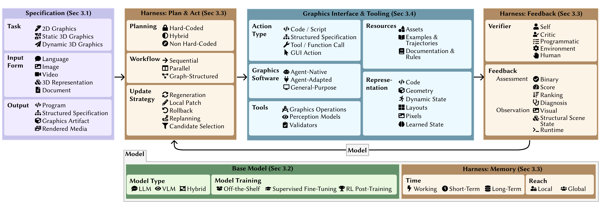
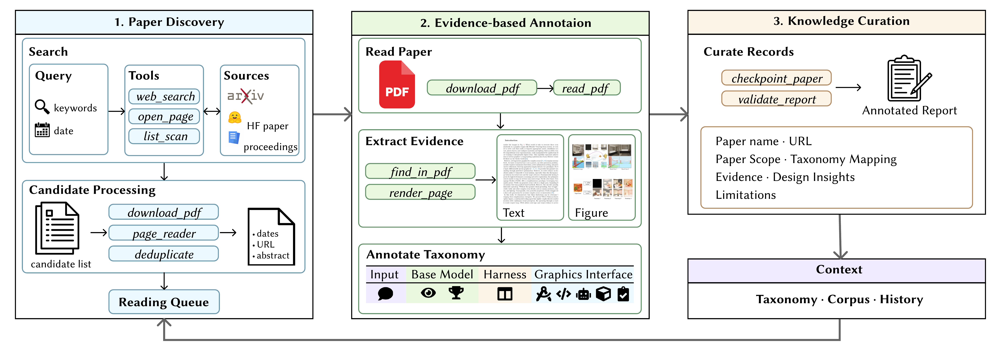
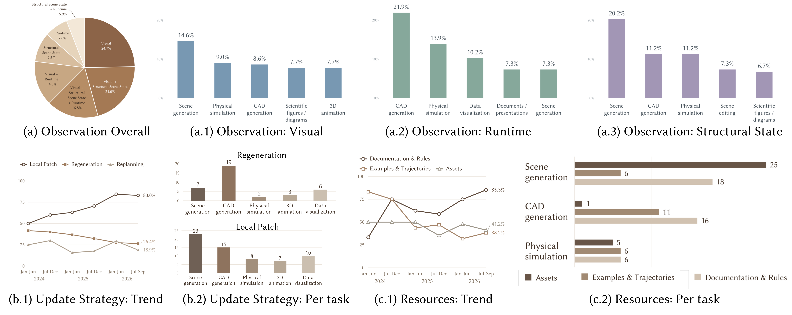
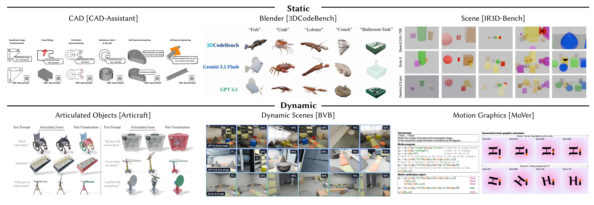

<h1 align="center">Awesome Agentic Graphics</h1>

<p align="center">
  <a href="https://github.com/sindresorhus/awesome"></a>
  <a href="LICENSE"></a>
  <!-- TODO: replace with the arXiv link once available -->
  <a href="#citation"></a>
  <!-- TODO: replace with the Hugging Face Daily Papers link once posted -->
  <a href="#citation"></a>
</p>


<p align="center">
  <a href="#overview">Overview</a> &nbsp;·&nbsp;
  <a href="#design-space">Design Space</a> &nbsp;·&nbsp;
  <a href="#taxonomy">Browse by task</a> &nbsp;·&nbsp;
  <a href="#papers">Papers</a> &nbsp;·&nbsp;
  <a href="#open-problems">Open Problems</a> &nbsp;·&nbsp;
  <a href="#contributing">Contributing</a> &nbsp;·&nbsp;
  <a href="#citation">Cite</a>
</p>



*Agentic graphics systems use language models to operate graphics tools and refine their outputs through feedback, across 2D shapes, static 3D assets, and dynamic 3D assets.*

## Overview

LLM agents can now write graphics code and refine it from feedback. We call a system an **agentic graphics system** when an LLM chooses actions, those actions run in a graphics environment, and feedback from the results shapes the next step.

This repository accompanies our survey of 300+ such papers (through Sep 2026) and provides:

- **A taxonomy** with four dimensions: *Specification*, *Base Model*, *Harness*, and *Graphics Interface & Tooling*.
- **An agentic survey system** that finds, reads, and annotates new papers.
- **A curated paper list** covering 2D graphics, static and dynamic 3D assets, and benchmarks.


## Design Space



*Four dimensions organize the design of agentic graphics systems. A single system may combine several options for the same choice.*

| Dimension | Design Choice | Options |
| :--- | :--- | :--- |
| **Specification** | Task | 2D Graphics · Static 3D Graphics · Dynamic 3D Graphics |
|  | Input Form | Language · Image · Video · 3D Representation · Document |
|  | Output | Program · Structured Specification · Graphics Artifact · Rendered Media |
| **Base Model** | Model Type | LLM · VLM · Hybrid |
|  | Model Training | Off-the-Shelf · Supervised Fine-Tuning · RL Post-Training |
| **Harness** | Planning | Hard-Coded · Hybrid · Non Hard-Coded |
|  | Workflow | Sequential · Parallel · Graph-Structured |
|  | Update Strategy | Regeneration · Local Patch · Rollback · Replanning · Candidate Selection |
|  | Verifier | Self · Critic · Programmatic · Environment · Human |
|  | Feedback: Assessment | Binary · Score · Ranking · Diagnosis |
|  | Feedback: Observation | Visual · Structural Scene State · Runtime |
|  | Memory Time | Working · Short-Term · Long-Term |
|  | Memory Reach | Local · Global |
| **Graphics Interface & Tooling** | Action Type | Code / Script · Structured Specification · Tool / Function Call · GUI Action |
|  | Graphics Software | Agent-Native · Agent-Adapted · General-Purpose |
|  | Tools | Graphics Operations · Perception Models · Validators |
|  | Resources | Assets · Examples & Trajectories · Documentation & Rules |
|  | Representation | Code · Geometry · Dynamic State · Scene Structure & Layouts · Pixels · Learned State |


## Agentic Literature Survey System

To keep pace with the field, we built an agentic system that maintains this list. Each run proceeds through three stages:

1. **Paper discovery.** Scan publication listings and search the web with iteratively refined queries, then deduplicate candidates into a reading queue.
2. **Evidence-based annotation.** Read the text and inspect figures and tables, gather supporting evidence, decide scope, and assign taxonomy labels.
3. **Knowledge curation.** Validate report structure and save each annotation with its evidence, design insights, and limitations, so later runs can resume and revisit records.



*The agent discovers candidate papers, annotates them against the taxonomy with source evidence, and curates records that inform later runs.*

> [!NOTE]
> We plan to release the survey system publicly. This section will link to it once available.

### Key Findings

Running the system over 350 papers published between 2024 and September 2026 (followed by manual verification of relevance) surfaces several patterns:

- **Visual feedback dominates.** It appears in 77.0% of the 304 works that use observations as feedback, and 58.2% combine several observation types. Scene generation leads in visual and structural observations; CAD generation leads in runtime observations.
- **Update strategies depend on the task.** CAD generation relies more on full regeneration, while scene generation favors local patches, likely because scene objects can be edited independently while CAD operations depend on earlier modeling steps.
- **Resources differ by task.** Scene generation leans on asset libraries; CAD generation leans on documentation and rules.
- **Trends over time.** Local patching rises from 50.0% to 83.0% across the analyzed period, and documentation & rules reach 85.3% of records in the latest period, suggesting a shift toward richer feedback, targeted revisions, and explicit task knowledge.
- **Base models are mostly off-the-shelf**, while harness designs are highly diverse. Code and structured specifications remain the dominant ways to act on graphics environments.



*Observation types, update strategies, and resources across tasks and over time.*

## Taxonomy

| Task | Categories |
| :--- | :--- |
| **[2D Graphics](#2d-graphics)** | [SVG and Vector Graphics](#svg-and-vector-graphics) · [Visual Design and Editing](#visual-design-and-editing) · [Scientific Figures and Diagrams](#scientific-figures-and-diagrams) · [Data Visualization](#data-visualization) · [Documents and Presentations](#documents-and-presentations) |
| **[Static 3D Assets](#static-3d-assets)** | [Object Modeling](#object-modeling) · [CAD Modeling](#cad-modeling) · [Scene Modeling](#scene-modeling) |
| **[Dynamic 3D Assets](#dynamic-3d-assets)** | [Articulation](#articulation) · [Animation](#animation) · [Simulation](#simulation) |
| **[Benchmarks and Datasets](#benchmarks-and-datasets)** | [Graphics Artifacts](#graphics-artifacts) · [Agentic Interaction and Coordination](#agentic-interaction-and-coordination) · [Spatial Understanding](#spatial-understanding) |
| **[Related Surveys](#related-surveys)** | [Agentic Visual Creation and Harnesses](#agentic-visual-creation-and-harnesses) |

## Papers

Dates show the earliest public release (`YY/MM`) when known, otherwise the publication year (`YY`). Each category is sorted newest first, and a paper may appear in more than one category.

<!-- BEGIN AUTO-GENERATED PAPER LIST -->

### 2D Graphics

[SVG and Vector Graphics](#svg-and-vector-graphics) · [Visual Design and Editing](#visual-design-and-editing) · [Scientific Figures and Diagrams](#scientific-figures-and-diagrams) · [Data Visualization](#data-visualization) · [Documents and Presentations](#documents-and-presentations)


#### SVG and Vector Graphics

| Publication | Paper Title | Code |
| :--- | :--- | :---: |
| 26/09 · arXiv | [Compositional SVG Generation via VLM-Driven Hierarchical Semantic Parsing](https://arxiv.org/abs/2609.14657) | — |
| 26/09 · arXiv | [TemplateCraft: Agentic Visual Template Generation](https://arxiv.org/abs/2609.31451) | — |
| 26 · ECCV’26 | [Render-in-the-Loop: Vector Graphics Generation via Visual Self-Feedback](https://arxiv.org/abs/2604.20730) | — |
| 26 · CVPR’26 | [IntroSVG: Learning from Rendering Feedback for Text-to-SVG Generation via an Introspective Generator-Critic Framework](https://arxiv.org/abs/2603.09312) | [](https://github.com/gitcat-404/IntroSVG)[](https://github.com/gitcat-404/IntroSVG) |
| 25/12 · arXiv | [AI Co-Artist: A LLM-Powered Framework for Interactive GLSL Shader Animation Evolution](https://arxiv.org/abs/2512.08951) | — |
| 25/11 · arXiv | [Decomate: Leveraging Generative Models for Co-Creative SVG Animation](https://arxiv.org/abs/2511.06297) | — |
| 25 · CHI’25 | [LogoMotion: Visually-Grounded Code Synthesis for Creating and Editing Animation](https://doi.org/10.1145/3706598.3714155) | — |

#### Visual Design and Editing

| Publication | Paper Title | Code |
| :--- | :--- | :---: |
| 26/10 · arXiv | [PLAYGROUND: Progressive Layout Generation with Render-Grounded Planning](https://arxiv.org/abs/2610.18865) | [](https://github.com/cvlab-kaist/PlayGround)[](https://github.com/cvlab-kaist/PlayGround) |
| 26/09 · arXiv | [Editable Visual Design](https://arxiv.org/abs/2609.04034) | [](https://github.com/yejy53/Editable-Design)[](https://github.com/yejy53/Editable-Design) |
| 26/01 · arXiv | [World Craft: Agentic Framework to Create Visualizable Worlds via Text](https://arxiv.org/abs/2601.09150) | [](https://github.com/HerzogFL/World-Craft)[](https://github.com/HerzogFL/World-Craft) |
| 26 · TPAMI | [Agentic Designer: Progressive Multi-Agent Collaboration for Structure-Aware Interior Layout Generation](https://doi.org/10.1109/TPAMI.2026.3711762) | — |
| 26 · CVPR’26 | [PSDesigner: Automated Graphic Design with a Human-Like Creative Workflow](https://arxiv.org/abs/2603.25738) | [](https://github.com/FudanCVL/PSDesigner)[](https://github.com/FudanCVL/PSDesigner) |
| 24/11 · CVPR’25 | [SketchAgent: Language-Driven Sequential Sketch Generation](https://sketch-agent.csail.mit.edu/) | [](https://github.com/yael-vinker/SketchAgent)[](https://github.com/yael-vinker/SketchAgent) |

#### Scientific Figures and Diagrams

| Publication | Paper Title | Code |
| :--- | :--- | :---: |
| 26/09 · arXiv | [ViCo: Visual-oriented Coding with Self-Reflection for Chart Replication](https://arxiv.org/abs/2609.16014) | [](https://github.com/Xigmoid/ViCo)[](https://github.com/Xigmoid/ViCo) |
| 26/05 · arXiv | [Crafter: A Multi-Agent Harness for Editable Scientific Figure Generation from Diverse Inputs](https://arxiv.org/abs/2605.30611) | [](https://github.com/HaozheZhao/Crafter)[](https://github.com/HaozheZhao/Crafter) |
| 26/05 · arXiv | [LiveFigure: Generating Editable Scientific Illustration with VLM Agents](https://arxiv.org/abs/2605.23527) | [](https://github.com/tsinghua-fib-lab/LiveFigure)[](https://github.com/tsinghua-fib-lab/LiveFigure) |
| 26/01 · arXiv | [PaperBanana: Automating Academic Illustration for AI Scientists](https://arxiv.org/abs/2601.23265) | [](https://github.com/dwzhu-pku/PaperBanana)[](https://github.com/dwzhu-pku/PaperBanana) |
| 26/01 · arXiv | [SciFig: Towards Automating Editable Figure Generation for Scientific Papers](https://arxiv.org/abs/2601.04390) | — |
| 26 · ACL’26 Demo | [AutoFigure-Edit: Generating Editable Scientific Illustrations via Reference-Guided Styling](https://aclanthology.org/2026.acl-demo.6/) | [](https://github.com/ResearAI/AutoFigure-Edit)[](https://github.com/ResearAI/AutoFigure-Edit) |
| 26 · ICLR’26 | [AutoFigure: Generating and Refining Publication-Ready Scientific Illustrations](https://openreview.net/forum?id=5N3z9JQJKq) | [](https://github.com/ResearAI/AutoFigure)[](https://github.com/ResearAI/AutoFigure) |
| 26 · Graphical Models | [MagicGeo: Training-free Text-Guided Geometric Diagram Generation](https://doi.org/10.1016/j.gmod.2026.101331) | — |
| 25/08 · arXiv | [See it. Say it. Sorted: Agentic System for Compositional Diagram Generation](https://arxiv.org/abs/2508.15222) | [](https://github.com/hantaoZhangrichard/see_it_say_it_sorted)[](https://github.com/hantaoZhangrichard/see_it_say_it_sorted) |
| 25/01 · arXiv | [ChartCoder: Advancing Multimodal Large Language Model for Chart-to-Code Generation](https://arxiv.org/abs/2501.06598) | [](https://github.com/thunlp/ChartCoder)[](https://github.com/thunlp/ChartCoder) |
| 25 · CVPR’25 | [From Words to Structured Visuals: A Benchmark and Framework for Text-to-Diagram Generation and Editing](https://arxiv.org/abs/2411.11916) | [](https://github.com/DiagramAgent/DiagramAgent_official)[](https://github.com/DiagramAgent/DiagramAgent_official) |
| 24 · NeurIPS’24 | [DeTikZify: Synthesizing Graphics Programs for Scientific Figures and Sketches with TikZ](https://openreview.net/forum?id=bcVLFQCOjc) | [](https://github.com/potamides/DeTikZify)[](https://github.com/potamides/DeTikZify) |

#### Data Visualization

| Publication | Paper Title | Code |
| :--- | :--- | :---: |
| 25/10 · arXiv | [VisCoder2: Building Multi-Language Visualization Coding Agents](https://arxiv.org/abs/2510.23642) | [](https://github.com/TIGER-AI-Lab/VisCoder2)[](https://github.com/TIGER-AI-Lab/VisCoder2) |
| 25/06 · arXiv | [VisCoder: Fine-Tuning LLMs for Executable Python Visualization Code Generation](https://arxiv.org/abs/2506.03930) | [](https://github.com/TIGER-AI-Lab/VisCoder)[](https://github.com/TIGER-AI-Lab/VisCoder) |
| 25 · WWW’25 | [PlotGen: Multi-Agent LLM-based Scientific Data Visualization via Multimodal Retrieval Feedback](https://doi.org/10.1145/3701716.3716888) | — |
| 24 · ACL’24 Findings | [MatPlotAgent: Method and Evaluation for LLM-Based Agentic Scientific Data Visualization](https://aclanthology.org/2024.findings-acl.701/) | [](https://github.com/thunlp/matplotagent)[](https://github.com/thunlp/matplotagent) |

#### Documents and Presentations

| Publication | Paper Title | Code |
| :--- | :--- | :---: |
| 26/09 · arXiv | [SLIDEFORGE: An LLM Agent for Controllable Editing of Slides as Structured Artifacts](https://arxiv.org/abs/2609.03109) | [](https://github.com/UIUC-MONET/SLIDEFORGE)[](https://github.com/UIUC-MONET/SLIDEFORGE) |
| 26/08 · arXiv | [SeaSlides: Semantic Abstraction Layer for Agentic Slide Generation](https://arxiv.org/abs/2608.03298) | — |
| 26/08 · arXiv | [PosterMELD: Multi-Agent Paper-to-Poster Generation for Controllable Design Diversity with Editable Print-Ready Outputs](https://arxiv.org/abs/2608.02218) | [](https://github.com/Shannon4Science/PosterMELD)[](https://github.com/Shannon4Science/PosterMELD) |
| 26/06 · arXiv | [MemSlides: A Hierarchical Memory Driven Agent Framework for Personalized Slide Generation with Multi-turn Local Revision](https://arxiv.org/abs/2606.17162) | [](https://github.com/huohua325/Memslides)[](https://github.com/huohua325/Memslides) |
| 26 · ACL’26 | [PosterForest: Hierarchical Multi-Agent Collaboration for Scientific Poster Generation](https://aclanthology.org/2026.acl-long.15/) | — |
| 26 · ACL’26 Findings | [DeepPresenter: Environment-Grounded Reflection for Agentic Presentation Generation](https://aclanthology.org/2026.findings-acl.1578/) | [](https://github.com/icip-cas/PPTAgent)[](https://github.com/icip-cas/PPTAgent) |
| 25/12 · arXiv | [SlideGen: Collaborative Multimodal Agents for Scientific Slide Generation](https://arxiv.org/abs/2512.04529) | — |
| 25/05 · arXiv | [Paper2Poster: Towards Multimodal Poster Automation from Scientific Papers](https://arxiv.org/abs/2505.21497) | [](https://github.com/Paper2Poster/Paper2Poster)[](https://github.com/Paper2Poster/Paper2Poster) |
| 25 · EMNLP’25 | [BannerAgency: Advertising Banner Design with Multimodal LLM Agents](https://aclanthology.org/2025.emnlp-main.214/) | [](https://github.com/sony/BannerAgency)[](https://github.com/sony/BannerAgency) |
| 25 · EMNLP’25 | [PPTAgent: Generating and Evaluating Presentations Beyond Text-to-Slides](https://aclanthology.org/2025.emnlp-main.728/) | [](https://github.com/icip-cas/PPTAgent)[](https://github.com/icip-cas/PPTAgent) |
| 25 · EMNLP’25 Findings | [PreGenie: An Agentic Framework for High-quality Visual Presentation Generation](https://aclanthology.org/2025.findings-emnlp.165/) | — |
| 25 · CVPR’25 | [AutoPresent: Designing Structured Visuals from Scratch](https://doi.org/10.1109/CVPR52734.2025.00276) | [](https://github.com/para-lost/AutoPresent)[](https://github.com/para-lost/AutoPresent) |

[↑ Back to contents](#taxonomy)

---

### Static 3D Assets

[Object Modeling](#object-modeling) · [CAD Modeling](#cad-modeling) · [Scene Modeling](#scene-modeling)


#### Object Modeling

| Publication | Paper Title | Code |
| :--- | :--- | :---: |
| 26/10 · arXiv | [SubDGuide: A Modeler-Inspired Agentic Workflow for Mesh-to-SubD Reconstruction](https://arxiv.org/abs/2610.11721) | — |
| 26/08 · arXiv | [ViSculpt: Visual-Centric Agentic Geometry Editing](https://arxiv.org/abs/2608.24169) | — |
| 26/08 · arXiv | [Agentic 3D Modeling with Procedural Control (Procedura)](https://arxiv.org/abs/2608.26238) | [](https://github.com/SpatiaOS/Procedura)[](https://github.com/SpatiaOS/Procedura) |
| 26/08 · arXiv | [aDSL: Agentic 3D Creation via Joint Agent-Program Design](https://arxiv.org/abs/2608.17975) | [](https://github.com/sig-pku/aDSL)[](https://github.com/sig-pku/aDSL) |
| 26/07 · arXiv | [Nova3D: Code-Native Generation of Programmable 3D Assets](https://arxiv.org/abs/2607.22738) | [](https://github.com/RareSense/Nova3D)[](https://github.com/RareSense/Nova3D) |
| 26/02 · SIGGRAPH’26 | [AGILE: Hand-Object Interaction Reconstruction from Video via Agentic Generation](https://arxiv.org/abs/2602.04672) | — |
| 25/10 · NeurIPS’25 | [ShapeCraft: LLM Agents for Structured, Textured and Interactive 3D Modeling](https://arxiv.org/abs/2510.17603) | [](https://github.com/SanBingYouYong/shapecraft)[](https://github.com/SanBingYouYong/shapecraft) |
| 25/09 · ICLR’26 | [MultiMat: Multimodal Program Synthesis for Procedural Materials using Large Multimodal Models](https://arxiv.org/abs/2509.22151) | — |
| 25/08 · arXiv | [LL3M: Large Language 3D Modelers](https://arxiv.org/abs/2508.08228) | [](https://github.com/threedle/ll3m)[](https://github.com/threedle/ll3m) |
| 25/06 · arXiv | [SmartAvatar: Text- and Image-Guided Human Avatar Generation with VLM AI Agents](https://arxiv.org/abs/2506.04606) | — |
| 25 · 3DV’25 | [3D-GPT: Procedural 3D Modeling with Large Language Models](https://arxiv.org/abs/2310.12945) | [](https://github.com/Chuny1/3DGPT)[](https://github.com/Chuny1/3DGPT) |
| 24/04 · COLING’25 | [Idea23D: Collaborative LMM Agents Enable 3D Model Generation from Interleaved Multimodal Inputs](https://aclanthology.org/2025.coling-main.280/) | [](https://github.com/yisuanwang/idea23d)[](https://github.com/yisuanwang/idea23d) |
| 24/02 · NAACL’25 Demo | [L3GO: Language Agents with Chain-of-3D-Thoughts for Generating Unconventional Objects](https://aclanthology.org/2025.naacl-demo.37/) | — |
| 24 · ECCV’24 | [BlenderAlchemy: Editing 3D Graphics with Vision-Language Models](https://doi.org/10.1007/978-3-031-73024-5_18) | [](https://github.com/ianhuang0630/BlenderAlchemyOfficial)[](https://github.com/ianhuang0630/BlenderAlchemyOfficial) |

#### CAD Modeling

| Publication | Paper Title | Code |
| :--- | :--- | :---: |
| 26/09 · arXiv | [AgenticCADedit: A Stateful, Tool-Mediated Agentic Approach to Multimodal 3D CAD Editing](https://arxiv.org/abs/2609.29621) | — |
| 26/09 · arXiv | [Vision2CAD: A Visual Agent Harness for Explicit Geometry Referencing and Localization in Parametric CAD Modeling](https://arxiv.org/abs/2609.22688) | — |
| 26/09 · arXiv | [CIT-CAD: Constraint Intent Tree-based CAD Code Generation and Verification](https://arxiv.org/abs/2609.07434) | — |
| 26/08 · arXiv | [RA-CAD: Learning Post-Execution Critique for State-Aware Text-to-CAD Generation](https://arxiv.org/abs/2608.05714) | — |
| 26/08 · arXiv | [CADIR: A Cross-Backend Editable Intermediate Representation for Agentic CAD Generation](https://arxiv.org/abs/2608.00891) | — |
| 26/06 · arXiv | [IterCAD: An Iterative Multimodal Agent for Visually-Grounded CAD Generation and Editing](https://arxiv.org/abs/2606.13368) | — |
| 26/04 · arXiv | [Zero-to-CAD: Agentic Synthesis of Interpretable CAD Programs at Million-Scale Without Real Data](https://arxiv.org/abs/2604.24479) | — |
| 26/03 · arXiv | [CADReasoner: Iterative Program Editing for CAD Reverse Engineering](https://arxiv.org/abs/2603.29847) | [](https://github.com/zhemdi/CADReasoner)[](https://github.com/zhemdi/CADReasoner) |
| 26/03 · arXiv | [GIFT: Bootstrapping Image-to-CAD Program Synthesis via Geometric Feedback](https://arxiv.org/abs/2603.27448) | — |
| 26/03 · arXiv | [CADSmith: Multi-Agent CAD Generation with Programmatic Geometric Validation](https://arxiv.org/abs/2603.26512) | — |
| 25/06 · arXiv | [BIMgent: Towards Autonomous Building Modeling via Computer-Use Agents](https://arxiv.org/abs/2506.07217) | [](https://github.com/ZihanDDD/BIMgent)[](https://github.com/ZihanDDD/BIMgent) |
| 25/05 · arXiv | [CADReview: Automatically Reviewing CAD Programs with Error Detection and Correction](https://arxiv.org/abs/2505.22304) | [](https://github.com/Gary-code/CADReview)[](https://github.com/Gary-code/CADReview) |
| 25/05 · ICLR’26 | [Seek-CAD: A Self-refined Generative Modeling for 3D Parametric CAD Using Local Inference via DeepSeek](https://arxiv.org/abs/2505.17702) | [](https://github.com/Sunny-Hack/Seek-CAD)[](https://github.com/Sunny-Hack/Seek-CAD) |
| 25 · CGF | [AIDL: A Solver-Aided Hierarchical Language for LLM-Driven CAD Design](https://doi.org/10.1111/cgf.70250) | — |
| 24/12 · ICCV’25 | [CAD-Assistant: Tool-Augmented VLLMs as Generic CAD Task Solvers](https://arxiv.org/abs/2412.13810) | — |
| 24/12 · arXiv | [BlenderLLM: Training Large Language Models for Computer-Aided Design with Self-improvement](https://arxiv.org/abs/2412.14203) | [](https://github.com/FreedomIntelligence/BlenderLLM)[](https://github.com/FreedomIntelligence/BlenderLLM) |
| 24/10 · ICLR’25 | [Generating CAD Code with Vision-Language Models for 3D Designs (CADCodeVerify)](https://arxiv.org/abs/2410.05340) | [](https://github.com/Kamel773/CAD_Code_Generation)[](https://github.com/Kamel773/CAD_Code_Generation) |

#### Scene Modeling

| Publication | Paper Title | Code |
| :--- | :--- | :---: |
| 26/10 · arXiv | [LiteReality-Agent: An Agentic System for Interactable 3D Indoor Scene Reconstruction](https://arxiv.org/abs/2610.01863) | [](https://github.com/LiteReality/LiteReality-Agent)[](https://github.com/LiteReality/LiteReality-Agent) |
| 26/09 · arXiv | [LEGO-Anything: Coding Agents for 3D Scene Reconstruction](https://arxiv.org/abs/2609.36380) | — |
| 26/08 · arXiv | [VibeWorlding: Can Multimodal Agents Construct 3D Open Worlds End-to-End?](https://arxiv.org/abs/2608.15265) | [](https://github.com/usail-hkust/VibeWorlding-Gym)[](https://github.com/usail-hkust/VibeWorlding-Gym) |
| 26/06 · arXiv | [MUSE: Agentic 3D Scene Authoring via Memory-Grounded Incremental Requirement Satisfaction](https://arxiv.org/abs/2606.14168) | — |
| 26/06 · arXiv | [SimFoundry: Modular and Automated Scene Generation for Policy Learning and Evaluation](https://arxiv.org/abs/2606.28276) | [](https://github.com/NVlabs/SimFoundry)[](https://github.com/NVlabs/SimFoundry) |
| 26/06 · arXiv | [SceneConductor: 3D Scene Generation from a Single Image with Multi-Agent Orchestration](https://arxiv.org/abs/2606.08402) | [](https://github.com/jhkim0759/SceneConductor)[](https://github.com/jhkim0759/SceneConductor) |
| 26/05 · arXiv | [Function2Scene: 3D Indoor Scene Layout from Functional Specifications](https://arxiv.org/abs/2605.30819) | — |
| 26/05 · arXiv | [Code-as-Room: Generating 3D Rooms from Top-Down View Images via Agentic Code Synthesis](https://arxiv.org/abs/2605.18451) | [](https://github.com/YxuanAr/Code-as-Room)[](https://github.com/YxuanAr/Code-as-Room) |
| 26/05 · arXiv | [WorldAct: Activating Monolithic 3D Worlds into Interactive-Ready Object-Centric Scenes](https://arxiv.org/abs/2605.15843) | [](https://github.com/SJTU-DeepVisionLab/WorldAct)[](https://github.com/SJTU-DeepVisionLab/WorldAct) |
| 26/05 · arXiv | [SimWorld Studio: Automatic Environment Generation with Evolving Coding Agent for Embodied Agent Learning](https://arxiv.org/abs/2605.09423) | — |
| 26/02 · arXiv | [SAGE: Scalable Agentic 3D Scene Generation for Embodied AI](https://arxiv.org/abs/2602.10116) | [](https://github.com/NVlabs/sage)[](https://github.com/NVlabs/sage) |
| 26/01 · arXiv | [VIGA: Vision-as-Inverse-Graphics Agent via Interleaved Multimodal Reasoning](https://arxiv.org/abs/2601.11109) | — |
| 26 · ICML’26 | [SceneSmith: Agentic Generation of Simulation-Ready Indoor Scenes](https://arxiv.org/abs/2602.09153) | [](https://github.com/nepfaff/scenesmith)[](https://github.com/nepfaff/scenesmith) |
| 26 · ICLR’26 | [PhyScensis: Physics-Augmented LLM Agents for Complex Physical Scene Arrangement](https://arxiv.org/abs/2602.14968) | — |
| 26 · ICLR’26 | [Scenethesis: A Language and Vision Agentic Framework for 3D Scene Generation](https://arxiv.org/abs/2505.02836) | — |
| 26 · 3DV’26 | [3D-Generalist: Vision-Language-Action Models for Crafting 3D Worlds](https://arxiv.org/abs/2507.06484) | — |
| 25/12 · arXiv | [VULCAN: Tool-Augmented Multi Agents for Iterative 3D Object Arrangement](https://arxiv.org/abs/2512.22351) | — |
| 25/08 · arXiv | [Holodeck 2.0: Vision-Language-Guided 3D World Generation with Editing](https://arxiv.org/abs/2508.05899) | [](https://github.com/bzx20/Holodeck2.0)[](https://github.com/bzx20/Holodeck2.0) |
| 25 · NeurIPS’25 | [SceneWeaver: All-in-One 3D Scene Synthesis with an Extensible and Self-Reflective Agent](https://arxiv.org/abs/2509.20414) | [](https://github.com/Scene-Weaver/SceneWeaver)[](https://github.com/Scene-Weaver/SceneWeaver) |
| 25 · CVPR’25 | [FirePlace: Geometric Refinements of LLM Common Sense Reasoning for 3D Object Placement](https://doi.org/10.1109/CVPR52734.2025.01257) | — |
| 24 · ICML’24 | [SceneCraft: An LLM Agent for Synthesizing 3D Scenes as Blender Code](https://arxiv.org/abs/2403.01248) | — |
| 24 · ECCV’24 | [I-Design: Personalized LLM Interior Designer](https://arxiv.org/abs/2404.02838) | [](https://github.com/atcelen/IDesign)[](https://github.com/atcelen/IDesign) |

[↑ Back to contents](#taxonomy)

---

### Dynamic 3D Assets

*Top: Articraft builds articulated assets through an SDK that couples part geometry with joint axes and motion limits. Bottom: Artisan adds part materials and masses, using physics feedback to guide repairs.*

#### Articulation

| Publication | Paper Title | Code |
| :--- | :--- | :---: |
| 26/10 · arXiv | [Towards Physically Grounded Articulated 3D Assets: A Multi-Agent Pipeline and Benchmark (Artisan)](https://arxiv.org/abs/2610.13947) | [](https://github.com/physicalvision/Artisan)[](https://github.com/physicalvision/Artisan) |
| 26/05 · arXiv | [Articraft: An Agentic System for Scalable Articulated 3D Asset Generation](https://arxiv.org/abs/2605.15187) | — |
| 24/10 · arXiv | [Articulate-Anything: Automatic Modeling of Articulated Objects via a Vision-Language Foundation Model](https://arxiv.org/abs/2410.13882) | [](https://github.com/vlongle/articulate-anything)[](https://github.com/vlongle/articulate-anything) |

#### Animation

| Publication | Paper Title | Code |
| :--- | :--- | :---: |
| 26/08 · arXiv | [ArtiMo: Agent-Driven Articulated Mesh Animation](https://arxiv.org/abs/2608.20699) | — |
| 26/08 · arXiv | [StateFlow: Building, Evolving, and Accessing 3D World States for Previsualization](https://arxiv.org/abs/2608.12314) | — |
| 26/08 · arXiv | [ParticleGen: A Multi-Agent System for Particle Effects Generation](https://arxiv.org/abs/2608.00629) | — |
| 26/06 · arXiv | [ManimAgent: Self-Evolving Multimodal Agents for Visual Education](https://arxiv.org/abs/2606.30296) | [](https://github.com/jwj1342/Paper2Manim)[](https://github.com/jwj1342/Paper2Manim) |
| 26/04 · arXiv | [Cutscene Agent: An LLM Agent Framework for Automated 3D Cutscene Generation](https://arxiv.org/abs/2604.25318) | — |
| 26/04 · arXiv | [OpenGame: Open Agentic Coding for Games](https://arxiv.org/abs/2604.18394) | [](https://github.com/leigest519/OpenGame)[](https://github.com/leigest519/OpenGame) |
| 26/02 · arXiv | [Code2Worlds: Empowering Coding LLMs for 4D World Generation](https://arxiv.org/abs/2602.11757) | [](https://github.com/AIGeeksGroup/Code2Worlds)[](https://github.com/AIGeeksGroup/Code2Worlds) |
| 25/01 · arXiv | [FilmAgent: A Multi-Agent Framework for End-to-End Film Automation in Virtual 3D Spaces](https://arxiv.org/abs/2501.12909) | [](https://github.com/HITsz-TMG/FilmAgent)[](https://github.com/HITsz-TMG/FilmAgent) |
| 24/10 · arXiv | [DreamGarden: A Designer Assistant for Growing Games from a Single Prompt](https://arxiv.org/abs/2410.01791) | — |

#### Simulation

| Publication | Paper Title | Code |
| :--- | :--- | :---: |
| 26/09 · arXiv | [DiagGen: Agentic Generation of Deformable Assets with Sim-based Diagnostics for Robotic Simulation](https://arxiv.org/abs/2609.23103) | [](https://github.com/diaggen/diaggen)[](https://github.com/diaggen/diaggen) |
| 26/09 · arXiv | [CoDimRecon: Agentic Reconstruction of Sim-Ready 3D Scenes with Deformable Curves, Surfaces, and Volumes](https://arxiv.org/abs/2609.36024) | — |
| 26/07 · arXiv | [GS-Agent: Creating 4D Physical Worlds With Generative Simulation](https://arxiv.org/abs/2607.21522) | — |
| 26/07 · arXiv | [SimWorlds: A Multi-Agent System for Dynamic 3D Scene Creation](https://arxiv.org/abs/2607.01766) | — |

[↑ Back to contents](#taxonomy)

---

### Benchmarks and Datasets

[Graphics Artifacts](#graphics-artifacts) · [Agentic Interaction and Coordination](#agentic-interaction-and-coordination) · [Spatial Understanding](#spatial-understanding)



*Representative benchmarks for static (CAD, Blender, scenes) and dynamic (articulated objects, dynamic scenes, motion graphics) graphics tasks.*

#### Graphics Artifacts

| Publication | Paper Title | Code |
| :--- | :--- | :---: |
| 26/10 · arXiv | [4DCodeBench: Benchmarking Agents on Inverse Graphics of Dynamic Scenes](https://arxiv.org/abs/2610.03715) | [](https://github.com/4DCodeBench/4DCodeBench)[](https://github.com/4DCodeBench/4DCodeBench) |
| 26/10 · arXiv | [BrickBench: Evaluating Agentic Brick Design](https://arxiv.org/abs/2610.12452) | [](https://github.com/kulits/BrickAgent)[](https://github.com/kulits/BrickAgent) |
| 26/09 · arXiv | [BVB: Benchmarking Agentic Video Understanding via Programmatic Reconstruction in Blender](https://arxiv.org/abs/2609.15478) | [](https://github.com/yunlong10/BVB)[](https://github.com/yunlong10/BVB) |
| 26/06 · arXiv | [3DCodeBench: Benchmarking Agentic Procedural 3D Modeling Via Code](https://arxiv.org/abs/2606.01057) | [](https://github.com/gaoypeng/3dcodebench)[](https://github.com/gaoypeng/3dcodebench) |
| 26/04 · arXiv | [VoxelCodeBench: Benchmarking 3D World Modeling Through Code Generation](https://arxiv.org/abs/2604.02580) | [](https://github.com/facebookresearch/voxelcodebench)[](https://github.com/facebookresearch/voxelcodebench) |
| 26 · ICML’26 | [Op-CAD: Benchmarking and Investigating Operation-oriented CAD Generation](https://proceedings.mlr.press/v306/bai26a.html) | — |
| 25/06 · arXiv | [IR3D-Bench: Evaluating Vision-Language Model Scene Understanding as Agentic Inverse Rendering](https://arxiv.org/abs/2506.23329) | [](https://github.com/LiuHengyu321/IR3D-Bench)[](https://github.com/LiuHengyu321/IR3D-Bench) |
| 25 · CVPR’25 | [BlenderGym: Benchmarking Foundational Model Systems for Graphics Editing](https://doi.org/10.1109/CVPR52734.2025.01731) | [](https://github.com/richard-guyunqi/BlenderGym-Open)[](https://github.com/richard-guyunqi/BlenderGym-Open) |
| 25 · TOG | [MoVer: Motion Verification for Motion Graphics Animations](https://doi.org/10.1145/3731209) | [](https://github.com/jama1017/MoVer)[](https://github.com/jama1017/MoVer) |
| 24/08 · ICLR’25 | [Can Large Language Models Understand Symbolic Graphics Programs?](https://arxiv.org/abs/2408.08313) | [](https://github.com/sgp-bench/sgp-bench)[](https://github.com/sgp-bench/sgp-bench) |
| 24 · CVPR’24 | [CADTalk: An Algorithm and Benchmark for Semantic Commenting of CAD Programs](https://arxiv.org/abs/2311.16703) | [](https://github.com/YYYYYHC/CADTalk)[](https://github.com/YYYYYHC/CADTalk) |

#### Agentic Interaction and Coordination

| Publication | Paper Title | Code |
| :--- | :--- | :---: |
| 26/09 · arXiv | [CADWorld: Computer-Use Benchmark for Long-Horizon Computer-Aided Design](https://arxiv.org/abs/2609.16251) | [](https://github.com/Zdong104/CADWORLD)[](https://github.com/Zdong104/CADWORLD) |
| 26/09 · arXiv | [3DHarnessBench: Probing Agentic 3D-to-Code Capabilities of Frontier Vision-Language Models](https://arxiv.org/abs/2609.06535) | [](https://github.com/llada60/3DHarnessBench)[](https://github.com/llada60/3DHarnessBench) |
| 26/07 · arXiv | [SceneActBench: Can Agents Act on the 3D Scenes They See?](https://arxiv.org/abs/2607.22393) | [](https://github.com/Feinaldo2/SceneActBench)[](https://github.com/Feinaldo2/SceneActBench) |
| 26/06 · arXiv | [Agents’ Last Exam](https://arxiv.org/abs/2606.05405) | [](https://github.com/rdi-berkeley/agents-last-exam)[](https://github.com/rdi-berkeley/agents-last-exam) |
| 26/06 · arXiv | [DeskCraft: Benchmarking Desktop Agents on Professional Workflows and Human-in-the-Loop Collaboration](https://arxiv.org/abs/2606.03103) | [](https://github.com/mrwwk/DeskCraft)[](https://github.com/mrwwk/DeskCraft) |
| 24/04 · NeurIPS’24 | [OSWorld: Benchmarking Multimodal Agents for Open-Ended Tasks in Real Computer Environments](https://arxiv.org/abs/2404.07972) | [](https://github.com/xlang-ai/OSWorld)[](https://github.com/xlang-ai/OSWorld) |

#### Spatial Understanding

| Publication | Paper Title | Code |
| :--- | :--- | :---: |
| 26/02 · arXiv | [Spa3R: Predictive Spatial Field Modeling for 3D Visual Reasoning](https://arxiv.org/abs/2602.21186) | [](https://github.com/hustvl/Spa3R)[](https://github.com/hustvl/Spa3R) |
| 26 · CVPR’26 | [VLM-3R: Vision-Language Models Augmented with Instruction-Aligned 3D Reconstruction](https://arxiv.org/abs/2505.20279) | [](https://github.com/VITA-Group/VLM-3R)[](https://github.com/VITA-Group/VLM-3R) |
| 25/12 · arXiv | [N3D-VLM: Native 3D Grounding Enables Accurate Spatial Reasoning in Vision-Language Models](https://arxiv.org/abs/2512.16561) | [](https://github.com/W-Ted/N3D-VLM)[](https://github.com/W-Ted/N3D-VLM) |
| 25 · ICCV’25 | [LLaVA-3D: A Simple yet Effective Pathway to Empowering LMMs with 3D Capabilities](https://arxiv.org/abs/2409.18125) | [](https://github.com/ZCMax/LLaVA-3D)[](https://github.com/ZCMax/LLaVA-3D) |
| 25 · CVPR’25 | [SpatialLLM: A Compound 3D-Informed Design towards Spatially-Intelligent Large Multimodal Models](https://arxiv.org/abs/2505.00788) | — |
| 24 · CVPR’24 | [SpatialVLM: Endowing Vision-Language Models with Spatial Reasoning Capabilities](https://arxiv.org/abs/2401.12168) | — |
| 24 · CVPR’24 | [OpenEQA: Embodied Question Answering in the Era of Foundation Models](https://openaccess.thecvf.com/content/CVPR2024/html/Majumdar_OpenEQA_Embodied_Question_Answering_in_the_Era_of_Foundation_Models_CVPR_2024_paper.html) | [](https://github.com/facebookresearch/open-eqa)[](https://github.com/facebookresearch/open-eqa) |
| 23/08 · ECCV’24 | [PointLLM: Empowering Large Language Models to Understand Point Clouds](https://arxiv.org/abs/2308.16911) | [](https://github.com/OpenRobotLab/PointLLM)[](https://github.com/OpenRobotLab/PointLLM) |
| 23/07 · NeurIPS’23 | [3D-LLM: Injecting the 3D World into Large Language Models](https://arxiv.org/abs/2307.12981) | [](https://github.com/UMass-Embodied-AGI/3D-LLM)[](https://github.com/UMass-Embodied-AGI/3D-LLM) |
| 23 · EMNLP’23 | [What’s “up” with Vision-Language Models? Investigating Their Struggle with Spatial Reasoning](https://aclanthology.org/2023.emnlp-main.568/) | [](https://github.com/amitakamath/whatsup_vlms)[](https://github.com/amitakamath/whatsup_vlms) |
| 22 · CVPR’22 | [ScanQA: 3D Question Answering for Spatial Scene Understanding](https://arxiv.org/abs/2112.10482) | [](https://github.com/ATR-DBI/ScanQA)[](https://github.com/ATR-DBI/ScanQA) |
| 20 · CVPR’20 | [ALFRED: A Benchmark for Interpreting Grounded Instructions for Everyday Tasks](https://arxiv.org/abs/1912.01734) | [](https://github.com/askforalfred/alfred)[](https://github.com/askforalfred/alfred) |
| 19/12 · ECCV’20 | [ScanRefer: 3D Object Localization in RGB-D Scans using Natural Language](https://arxiv.org/abs/1912.08830) | [](https://github.com/daveredrum/ScanRefer)[](https://github.com/daveredrum/ScanRefer) |

[↑ Back to contents](#taxonomy)

---

### Related Surveys

[Agentic Visual Creation and Harnesses](#agentic-visual-creation-and-harnesses)

#### Agentic Visual Creation and Harnesses

| Publication | Paper Title | Code |
| :--- | :--- | :---: |
| 26/09 · Preprints | [Beyond Visual Generation: Frontiers, Challenges, and Future Directions in Agentic Visual Creation](https://www.preprints.org/manuscript/202609.0682/v1) | — |
| 26/09 · arXiv | [Agentic Visual Generation: From Generative Models to Agentic Control](https://arxiv.org/abs/2609.06758) | [](https://github.com/YinmingHuang/Awesome-agentic-visual-generation-model)[](https://github.com/YinmingHuang/Awesome-agentic-visual-generation-model) |
| 26/09 · Preprints | [Agentic Visual Generation: A Survey](https://www.preprints.org/manuscript/202609.0173/v1) | — |
| 26/09 · FCS | [Agent Systems with Harness Engineering: A Systematic Survey](https://doi.org/10.1007/s11704-026-61123-6) | — |
| 26/08 · arXiv | [Agentic Artifact Creation: Systems, Evaluation, Principles, and Opportunities](https://arxiv.org/abs/2608.28122) | [](https://github.com/GeminiLight/awesome-agentic-artifact-creation)[](https://github.com/GeminiLight/awesome-agentic-artifact-creation) |
| 26/04 · Preprints | [Agent Harness for Large Language Model Agents: A Survey](https://www.preprints.org/manuscript/202604.0428/v3) | — |
| 26 · OpenReview | [Agent Harness Engineering: A Survey](https://openreview.net/pdf?id=eONq7FdiHa) | — |
| 26 · ACM CSUR | [Large Language Models for Computer-Aided Design: A Survey](https://doi.org/10.1145/3787499) | [](https://github.com/lichengzhanguom/LLMs-CAD-Survey-Taxonomy)[](https://github.com/lichengzhanguom/LLMs-CAD-Survey-Taxonomy) |
| 23 · CGF STAR | [Neurosymbolic Models for Computer Graphics](https://arxiv.org/abs/2304.10320) | — |
| 20 · CGF STAR | [Learning Generative Models of 3D Structures](https://doi.org/10.1111/cgf.14020) | — |

[↑ Back to contents](#taxonomy)

---

<!-- END AUTO-GENERATED PAPER LIST -->

## Open Problems

- **Multi-agent collaboration and cross-task generalization.** Moving from task-specific pipelines to agents that decompose objectives, coordinate specialized expertise, and share skills across tools and domains whose representations may not be compatible.
- **Action spaces and tool orchestration.** Deciding which of code, GUI actions, API calls, and domain-specific programs suits a task, when to switch between them, and how to balance reliability, editability, and cost.
- **Agent-oriented interfaces and representations.** Designing languages and abstractions for agents (e.g. solver-aided DSLs like AIDL) while keeping results inspectable and editable by human designers.
- **Long-horizon planning, memory, and efficiency.** Maintaining project state, tracking design decisions and dependencies, learning from failed attempts, and balancing quality against compute.
- **Transparency and interpretability.** Exposing plans, assumptions, intermediate artifacts, and edit histories without overwhelming users with low-level detail.
- **Human interaction and intent alignment.** Handling underspecified, subjective requests ("make it cleaner") through proactive clarification, explicit assumptions, and shared vocabularies built with users.
- **Reliable evaluation and validation.** VLM critics miss subtle, physical, and geometric errors; runs are stochastic; proprietary models confound system-level gains; expert evaluation is hard to scale.
- **Creativity and attribution.** Understanding how creative decisions are distributed between users and agents, and supporting provenance and meaningful human control.

## Contributing

Paper suggestions are welcome. To be in scope, a work must meet the three criteria in [Overview](#overview): an LLM makes action decisions, the system operates on a graphics environment, and feedback from that environment shapes later actions. Please open an issue or pull request with the paper title, link, venue, and the category it belongs to.

## Citation

If you find this survey or repository useful, please cite:

```bibtex
@article{agenticgraphics2026,
  title   = {Advances in Agentic Computer Graphics},
  author  = {TBD},
  journal = {arXiv preprint arXiv:TBD},
  year    = {2026}
}
```
