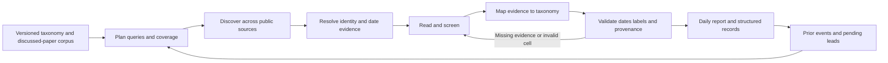

# Taxonomy-grounded daily literature agent

This is an implemented skill workflow for the survey, not a claim of a new foundation model or measured state-of-the-art retrieval performance. The paper taxonomy and discussion corpus act as versioned research memory; the agent selects queries and tools, reads evidence, revises uncertain classifications, and records persistent findings.

## Inputs and control

Inputs are an exact target day/timezone/as-of time, the taxonomy and corpus revision, bounded source/query budgets, and optional prior reports. The user can invoke the skill manually; an explicitly requested scheduler can invoke the same entrypoint. The skill itself does not run in the background.

The model performs semantic query expansion, scope screening, evidence reading, conservative taxonomy mapping, and source-gap decisions. Python performs deterministic date conversion, required-label checks, duplicate checks, known-list matching, prior-event comparison, input hashing and report rendering. This separation makes common reporting failures reproducible without presenting model judgments as programmatic proof.

The current taxonomy's 18 fields are: Task; Input Form; Output; Model Type; Model Training; Planning; Workflow; Update Strategy; Verifier; Feedback Assessment; Feedback Observation; Memory Time; Memory Reach; Action Type; Graphics Software Readiness; Tools; Resources; Representation. Application category and operation are additional paper-list facets. The source Tools discussion is provisional, and the source's memory definition contains an ambiguity; the system preserves these caveats rather than resolving them without editorial agreement.

## Output contract

| Information | Purpose |
|---|---|
| Target day, timezone, as-of, document revision and hashes | Reproduce the scope and source state |
| New submissions, revisions/publications, catch-up, already reported, unresolved and excluded | Prevent date and novelty conflation |
| Title, authors, IDs, paper/project/code/data links | Locate and deduplicate the work |
| Primary-source date event, raw value, precision and timezone | Audit same-day eligibility |
| Application families, operation and contribution | Route to survey discussion sections |
| Inclusion decision, confidence and evidence | Separate core, enabling, uncertain and excluded work |
| All 18 taxonomy fields, evidence location and derived reasoning | Produce a traceable taxonomy row |
| Nearest known method and supported difference, evaluation and next action | Prioritize reading and survey maintenance |
| Missing fields, access limits and taxonomy deltas | Avoid forced classification and expose unresolved work |
| Per-source and per-query-family ledger, budget, pending queue | Explain coverage and support the next run |

Only identity, dates, taxonomy membership, evidence presence and structural constraints are checked deterministically. Primary-source truth and semantic classification still need the reading agent's judgment. A discussed-list match is not proof of accepted manuscript membership.

## Evaluation suitable for the survey

Report separate measures: valid-event precision; taxonomy agreement with manually annotated primary evidence; duplicate/repeat suppression; provenance completeness; latency/tool budget; and discovery recall on a dated, independently established reference set. A known-paper positive-control test checks reading/classification and date handling, not discovery recall. A zero-result live run checks graceful completion and coverage disclosure, not the ability to recover positive cases. Synthetic fixtures test boundary behavior only.

Do not claim that every paper on a day is recoverable: public announcement timing, indexing delays, inaccessible sources and the finite search budget constrain recall. A separate lookback queue reduces delayed-index misses without relabeling old work as today's papers. The system should expose which of these limits occurred in each run.
